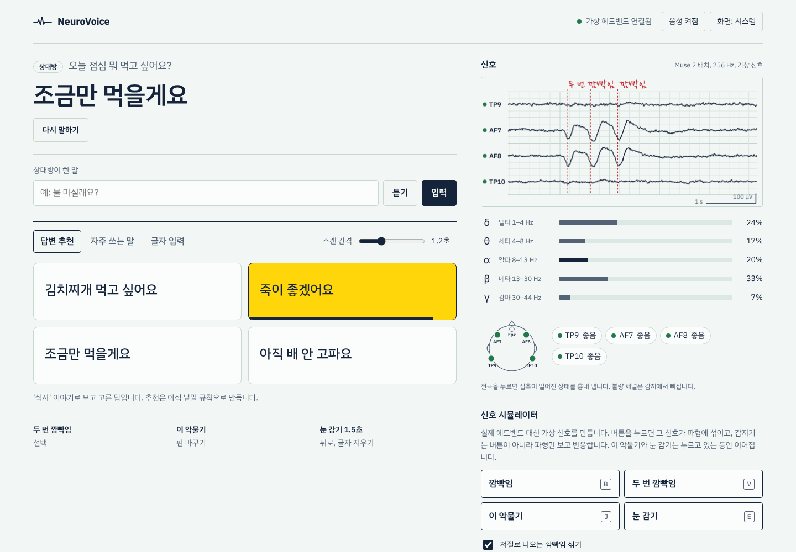
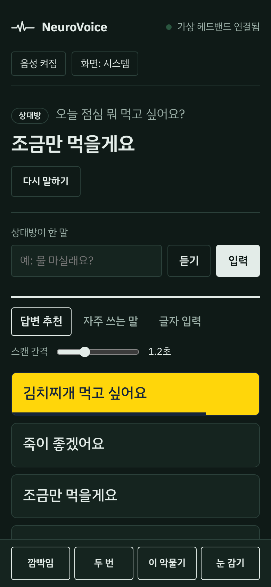
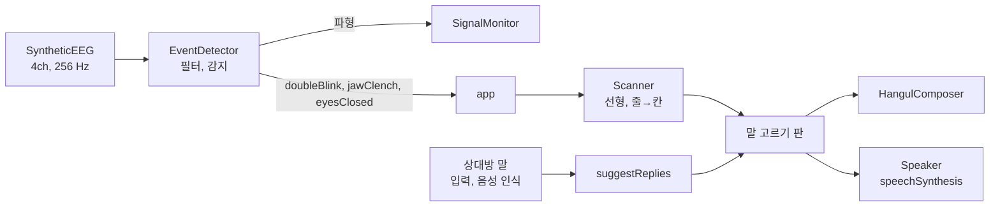

# NeuroVoice

깜빡임, 이 악물기, 눈 감기(알파파)만으로 할 말을 고르고 목소리로 내보내는 보조 의사소통 UI 프로토타입입니다.

*A switch-scanning AAC prototype driven by EEG headband events (double blink, jaw clench, eyes-closed alpha), with an in-browser signal simulator.*



## 지금 상태

- **UI 프로토타입**입니다. 화면의 신호는 모두 브라우저 안의 시뮬레이터가 만든 **가상 신호**입니다.
- 실제 EEG 헤드밴드(Muse 2 등)와는 아직 연결하지 않았습니다. 연결 계획은 [로드맵](#로드맵)에 있습니다.
- 감지기는 시뮬레이터 버튼을 보지 않고 **파형만 보고** 판단합니다. 신호 소스만 실제 장비로 바꾸면 나머지 파이프라인은 그대로 쓰도록 나눠 두었습니다.
- 연구·취미용이며 의료기기가 아닙니다.

## 입력 신호

| 신호 | 어디서 잡나 | 하는 일 |
|---|---|---|
| 두 번 깜빡임 (0.8초 안에 2회) | AF7, AF8 이마 쪽의 큰 음의 편향 | 선택 |
| 이 악물기 | TP9, TP10의 30 Hz 이상 근전도(EMG) 증가 | 판 바꾸기 |
| 눈 감기 1.5초 | TP9, TP10의 알파(8–13 Hz) 비율 상승 | 뒤로, 글자 지우기 |

한 번 깜빡임은 선택으로 치지 않습니다. 시뮬레이터는 3~7초마다 저절로 나오는 깜빡임을 섞어서, 평소 깜빡임이 오작동을 일으키지 않는지 확인할 수 있게 합니다.

## 기능

- **답변 추천**: 상대방이 한 말(직접 입력 또는 음성 인식)을 보고 답 4개를 띄웁니다. 지금은 13개 주제의 낱말 규칙으로 고르며, 언어 모델로 바꿀 자리를 같은 모양의 함수로 비워 두었습니다.
- **자주 쓰는 말**: 네, 아니요, 물 주세요, 아파요 같은 12개 문장을 줄→칸 순서로 훑습니다.
- **글자 입력**: 줄→칸 스캐닝 자모 키보드입니다. 두벌식 조합(겹받침, 이중모음, 받침 넘김)을 지원하고, 자주 쓰는 자모가 먼저 오도록 배열했습니다.
- **말하기**: 브라우저 음성 합성(ko-KR)으로 읽습니다.
- **지연 보정**: 두 번째 깜빡임을 확인하는 사이 하이라이트가 다음 칸으로 넘어가도, 첫 깜빡임이 시작된 순간 켜져 있던 항목을 고릅니다.
- **신호 모니터**: 4채널 파형을 EEG 기록지처럼 그립니다(0.2초/1초 격자, 100 µV 눈금). 감지된 지점에는 빨간 펜 메모를, 눈 감은 구간에는 음영을 남깁니다. 대역별(δ θ α β γ) 비율과 전극 접촉 상태도 보여 줍니다.
- **접촉 불량 흉내**: 전극을 누르면 그 채널이 떨어진 상태가 됩니다. 불량 채널은 감지에서 빠지고, 반대쪽 채널로 계속 동작합니다.



## 실행

빌드 과정이 없습니다. 저장소를 받은 뒤 `index.html`을 브라우저로 열거나, 로컬 서버로 띄웁니다.

```bash
cd neurovoice
python3 -m http.server 5173
# http://localhost:5173
```

- 시뮬레이터 단축키: `B` 깜빡임, `V` 두 번 깜빡임, `J` 이 악물기(누르고 있기), `E` 눈 감기(누르고 있기)
- 브라우저 콘솔에서 `NV.app.sim.doubleBlink()`처럼 신호를 직접 넣어 볼 수 있습니다.
- 한 파일짜리 버전: `npm run build` → `dist/neurovoice.html`

## 구조



| 파일 | 역할 |
|---|---|
| `src/dsp.js` | FFT, Hann 창, 파워 스펙트럼, Goertzel, 바이쿼드 필터, 링 버퍼 |
| `src/simulator.js` | Muse 2 배치(TP9, AF7, AF8, TP10) 가상 EEG와 인공물(깜빡임, 근전도, 접촉 불량) |
| `src/detector.js` | 깜빡임, 이 악물기, 알파 감지와 대역 비율, 접촉 품질 |
| `src/scanner.js` | 자동 스캐닝(선형, 줄→칸)과 지연 보정용 상태 스냅샷 |
| `src/hangul.js` | 두벌식 한글 조합기 |
| `src/suggest.js` | 답변 추천(규칙 기반) |
| `src/speech.js` | 음성 합성, 음성 인식 |
| `src/monitor.js` | 캔버스 파형 그리기 |
| `src/app.js` | 연결과 화면 상태 |

외부 의존성은 없습니다. 모든 스크립트는 브라우저와 Node 양쪽에서 읽히는 형태(UMD)라서 신호 처리 코드를 그대로 테스트합니다.

## 신호 처리

- 채널마다 0.5 Hz 고역통과 → 60 Hz 노치(국내 전원 주파수) → 40 Hz 저역통과를 겁니다. 근전도는 노치 뒤에 30 Hz 고역통과를 따로 걸고 100 ms RMS로 봅니다.
- **깜빡임**: AF7, AF8 평균이 −70 µV 아래로 내려갔다 돌아오는 구간(60~700 ms). 두 깜빡임의 시작 간격이 0.8초 이내면 두 번 깜빡임입니다.
- **이 악물기**: TP9, TP10 근전도 RMS가 max(12 µV, 평소 값×3.5)를 0.15초 넘게 유지할 때.
- **눈 감기**: 1초 창(256점) 스펙트럼에서 알파(8–13 Hz)가 1–44 Hz 전력에서 차지하는 비율이 max(0.4, 평소 값×1.8)를 1초 넘게 유지할 때. 125 ms마다 다시 계산합니다.
- **접촉 품질**: 원신호의 60 Hz 성분 크기(Goertzel). 8 µV 미만 좋음, 20 µV 미만 보통, 그 이상 불량.
- 임계값은 시뮬레이터에 맞춘 값입니다. 실제 장비에서는 사람마다 보정이 필요합니다.

## 테스트

```bash
npm test   # node --test, 설치할 것 없음
```

DSP, 한글 조합, 답변 추천, 스캐너, 감지기를 확인하는 23개 테스트가 있습니다. 감지기 테스트는 가상 신호로 두 번 깜빡임, 저절로 나는 깜빡임 90초, 이 악물기, 눈 감기, 전극 접촉 불량을 재현합니다.

## 로드맵

- [ ] Muse 2 연결: BrainFlow(Python)로 받아 WebSocket으로 브라우저에 전달
- [ ] 사용자별 보정 화면(임계값 자동 설정)
- [ ] 답변 추천을 언어 모델로 교체(대화 맥락 반영)
- [ ] 글자 입력 단어 예측
- [ ] OpenBCI와 후두부 전극으로 SSVEP 선택 실험

## 참고

- 전극 이름은 국제 10-10 배치를 따릅니다. Muse 2는 TP9, AF7, AF8, TP10 네 곳과 기준 전극 Fpz를 씁니다.
- 스캐닝 방식은 보완대체의사소통(AAC) 기기의 스위치 스캐닝을 따랐습니다.

## 라이선스

[MIT](LICENSE)
